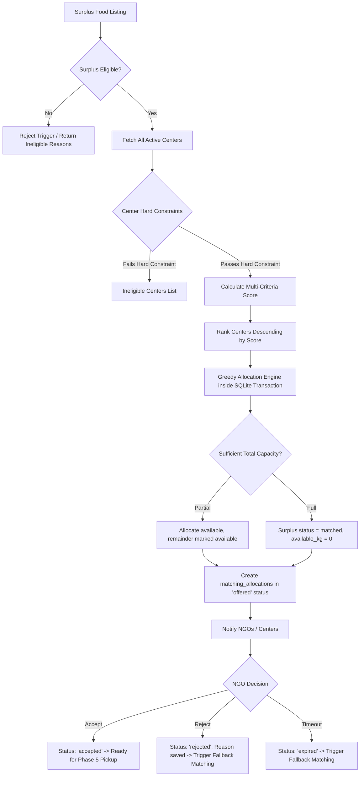

# Campus FoodConnect – Phase 4: Intelligent Food Matching & Allocation

## 1. Overview & Objective

Phase 4 implements the core intelligence engine for the **Campus FoodConnect** platform. It connects verified surplus food listings from campus canteens to verified distribution centers (NGOs, community kitchens, student pantries) using a **Hybrid Rule-Based Multi-Criteria Matching Algorithm with Greedy Capacity Allocation**.

Key capabilities delivered in Phase 4:
- **Two-Tier Validation**: Strict filtering on safety verification, expiration, remaining quantity, center operating status, dietary category compatibility, and transit time limits.
- **Multi-Criteria Optimization**: Ranking centers with a weighted 4-factor scoring model ($D, C, T, U$).
- **Greedy Capacity Partitioning**: Efficient multi-center splitting when a single center cannot accommodate the entire surplus.
- **ACID Transaction Safety**: Atomic allocation with row locking and SQLite `CHECK` constraints preventing over-allocation or negative inventory.
- **Complete Offer Lifecycle**: Real-time offer notification, acceptance confirmation, rejection with mandatory reason recording, timeout expiration, and automated fallback rematching.
- **Simulated Routing Transparency**: Strict separation of straight-line distance, road distance estimation, and travel time with explicit `isLiveRouting: false` disclaimers.

---

## 2. Architecture & Matching Pipeline



---

## 3. Mandatory Hard Eligibility Constraints

Before calculating match scores, candidates must satisfy strict safety and operational criteria:

### A. Surplus Listing Constraints
1. **Food Safety Verification**: Status must be `verified` by a campus food safety officer (`food_safety_status = 'verified'`). Any listing with `pending` or `rejected` status is immediately blocked.
2. **Surplus Lifecycle Status**: Listing status must be `available` or `partially_allocated`. Listings with status `matched`, `completed`, `cancelled`, or `expired` are rejected.
3. **Available Quantity**: `available_quantity_kg > 0`.
4. **Pickup Deadline**: Current time must be strictly before the specified `pickup_deadline`.
5. **Mandatory Metadata**: Storage method, storage temperature (numeric with valid unit), ingredients, allergens, and preparation time must be non-empty.

### B. Distribution Center Constraints
1. **Verification & Active Status**: `is_verified = 1` and account active.
2. **Geographic Coordinates**: Valid latitude (-90 to 90) and longitude (-180 to 180).
3. **Available Storage Capacity**: Authoritative available capacity must be $> 0$ kg (calculated dynamically via `totalCapacityKg - (committedKg + occupiedKg)`).
4. **15-Minute Transit Window**: Estimated travel time between canteen and distribution center must be $\le 15$ minutes. Centers exceeding 15 minutes are strictly excluded.
5. **Dietary Category Compatibility**: The center must accept the surplus category (or declare `'Other'`). If categories are defined, any listing whose category is not accepted is excluded.

---

## 4. Multi-Criteria Scoring Formula

Eligible distribution centers are scored using a normalized weighted index between **0 and 100**:

$$\text{Match Score } (S) = 0.35 \times D + 0.25 \times C + 0.25 \times T + 0.15 \times U$$

Where each sub-score is normalized between 0 and 100:

### 1. Demand Compatibility Score ($D$, 35% weight)
- **100**: Center explicitly lists the surplus category and currently reports unmet demand (`demand_kg > 0`).
- **90**: Center explicitly lists the category with general demand.
- **60**: Center has general intake with no category restrictions.
- **50**: Category matched via fallback `'Other'`.
- **0**: Incompatible category.

### 2. Available Capacity Score ($C$, 25% weight)
- Evaluates how comfortably the center accommodates the food without exceeding capacity or becoming bottlenecked:
  $$\text{Full Accommodation: } C = \text{round}(100 - (\text{surplusQty} / \text{availableCapacityKg}) \times 15)$$
  $$\text{Partial Accommodation: } C = \text{round}((\text{availableCapacityKg} / \text{surplusQty}) \times 70)$$

### 3. Estimated Road Travel Time Score ($T$, 25% weight)
- Prioritizes centers nearest to the canteen within the 15-minute transit window:
  $$T = \max\left(0, \text{round}\left(100 - \frac{\text{travelTimeMin}}{15} \times 60\right)\right)$$
  - Example: A 3-minute travel time yields $T \approx 88$, while a 15-minute travel time yields $T \approx 40$.

### 4. Center Urgency Level Score ($U$, 15% weight)
- Reflects beneficiary demand priority registered by the center:
  - **`high`**: 100
  - **`medium`**: 60
  - **`low`**: 30

### Tie-Breaking Determinism
When two or more distribution centers have identical total match scores, ranking resolves deterministically by:
1. Shortest estimated travel time (`estimatedTravelTimeMin` ASC)
2. Largest available capacity (`availableCapacityKg` DESC)
3. Distribution center database ID (`id` ASC)

---

## 5. Greedy Allocation Engine & Transactional Safety

When matching is triggered:
1. **Exclusive Transaction**: Executed inside a SQLite `db.transaction()` to prevent race conditions from concurrent allocation requests.
2. **Fresh Re-Check**: Surplus listing is re-fetched with row-level locking to verify remaining quantity has not changed.
3. **Iterative Greedy Allocation**:
   - The engine iterates through ranked eligible centers in descending score order.
   - For each center, `allocatedAmount = min(remainingSurplusKg, centerAvailableCapacityKg)`.
   - If `allocatedAmount > 0`:
     - An allocation record is inserted into `matching_allocations` with status `'offered'`.
     - Center available capacity is decremented immediately in the database.
     - `remainingSurplusKg` is decremented.
   - If `remainingSurplusKg` reaches 0, the loop terminates.
4. **Surplus Status Synchronization**:
   - If `remainingSurplusKg == 0`: Listing status updated to `'matched'`.
   - If `remainingSurplusKg > 0` and at least 1 allocation was made: Listing status updated to `'partially_allocated'`.
   - If 0 allocations could be made: Listing status remains unchanged, returning `no_eligible_centers`.
5. **Integrity Invariants**:
   - SQLite `CHECK (available_quantity_kg >= 0 AND available_quantity_kg <= quantity_kg)` enforces non-negative bounds.
   - SQLite unique partial index `idx_allocations_active_unique` prevents duplicate concurrent offers to the same center for the same listing.

---

## 6. Offer Lifecycle & Fallback Workflows

### Offer States
- **`offered`**: Initial state upon algorithm execution. Center capacity is committed.
- **`accepted`**: Center NGO explicitly accepts the allocation. Timestamp and user ID recorded. Status advances to Phase 5 delivery readiness.
- **`rejected`**: Center NGO explicitly declines the allocation. **A non-empty rejection reason is mandatory**.
- **`expired`**: Offer was not accepted within the timeout threshold (configurable, default 15 minutes).
- **`cancelled`**: Offer retracted due to listing cancellation or safety officer intervention.

### Automatic Fallback Redistribution
When an allocation transitions to `'rejected'` or `'expired'`:
1. The allocated quantity is returned to the surplus listing's `available_quantity_kg`.
2. The center's capacity is released (`CenterModel.syncAvailableCapacity(centerId)`).
3. The matching engine automatically triggers fallback allocation for the newly available quantity.
4. Centers that previously rejected the listing or have active allocations for it are strictly excluded from the fallback pool.
5. If eligible fallback centers exist, new offers are generated immediately.

---

## 7. API Reference & Role-Based Authorization

| Method | Endpoint | Allowed Roles | Description |
| :--- | :--- | :--- | :--- |
| `POST` | `/api/matching/trigger/:surplusId` | `canteen`, `admin` | Runs intelligent matching algorithm and generates allocation offers. Canteens can only trigger matching for their own listings. |
| `GET` | `/api/matching/rankings/:surplusId` | `canteen`, `ngo`, `admin`, `safety_officer` | Returns full candidate center ranking, match scores, breakdown, and detailed ineligibility reasons without modifying data. |
| `GET` | `/api/matching/allocations/:surplusId` | `canteen`, `ngo`, `admin`, `volunteer` | Lists all active and historical allocations for a specific surplus listing. |
| `GET` | `/api/matching/offers` | `ngo`, `admin` | Returns allocation offers for the authenticated user's distribution center. Supports `?status=offered` filter. |
| `GET` | `/api/matching/offers/:allocationId` | `ngo`, `admin`, `canteen` | Returns full details of a specific allocation offer. |
| `PUT` | `/api/matching/offers/:allocationId/accept` | `ngo`, `admin` | Accepts an allocation offer. NGO can only accept offers for their own center. |
| `PUT` | `/api/matching/offers/:allocationId/reject` | `ngo`, `admin` | Rejects an offer with mandatory `{ rejectionReason }`. Triggers automated fallback redistribution. |
| `POST` | `/api/matching/process-expired` | `admin`, `safety_officer` | Sweeps offers exceeding `{ timeoutMinutes }` (default 15), marks them `expired`, and runs fallback redistribution. |
| `GET` | `/api/matching/nearby/:surplusId` | `canteen`, `ngo`, `admin`, `volunteer`, `safety_officer` | Evaluates nearby centers with live routing metadata and map coordinates (Phase 3 compatibility). |

---

## 8. Simulated Routing & Safe Transition Notice

All distance and travel time estimates are generated by `RoutingService`:
- **`straightLineDistanceKm`**: Calculated using exact Haversine great-circle formula.
- **`estimatedRoadDistanceKm`**: Modeled with an urban campus winding factor ($1.38\times$).
- **`estimatedTravelTimeMin`**: Modeled at campus transit speed (~22 km/h) or calibrated center matrix.
- **`isLiveRouting: false`**: Every API response explicitly flags that routing is simulated.
- **`routingProvider: "simulated_campus_road_network"`**: The 15-minute transit window is explicitly labeled as a simulated estimate.
- **Pluggable Interface**: `RoutingService.queryLiveOsrm()` is implemented and ready to connect when `OSRM_BASE_URL` is configured in production.

---

## 9. Notification & Audit Log Integration

Every Phase 4 action generates persistent database records:
- **`notifications`**: Real-time alerts sent to center NGO users when new offers are created, and to canteen coordinators when offers are accepted or rejected.
- **`audit_logs`**: System audit events recorded for `MATCHING_TRIGGERED`, `ALLOCATION_OFFERED`, `ALLOCATION_ACCEPTED`, `ALLOCATION_REJECTED`, and `ALLOCATION_EXPIRED`.

---

## 10. Verification & Test Suite Results

The Phase 4 test suite (`test-phase4.js`) executes 64 comprehensive integration checks covering all 28 required test scenarios:

```
📊 Full Test Suite Execution Summary:
- Phase 1 Database Verification:          23/23 PASSED
- Phase 1 Express Server Integration:     12/12 PASSED
- Phase 2 Authentication & Authorization: 34/34 PASSED
- Phase 3 Surplus & Distribution Centers: 56/56 PASSED
- Phase 3 Review & Security Checks:       33/33 PASSED
- Phase 3 Map Eligibility Audit:          35/35 PASSED
- Phase 4 Intelligent Matching Suite:     64/64 PASSED
------------------------------------------------------
Total Passed Checks:                     257/257 PASSED (100% clean)
Failures:                                0
```

